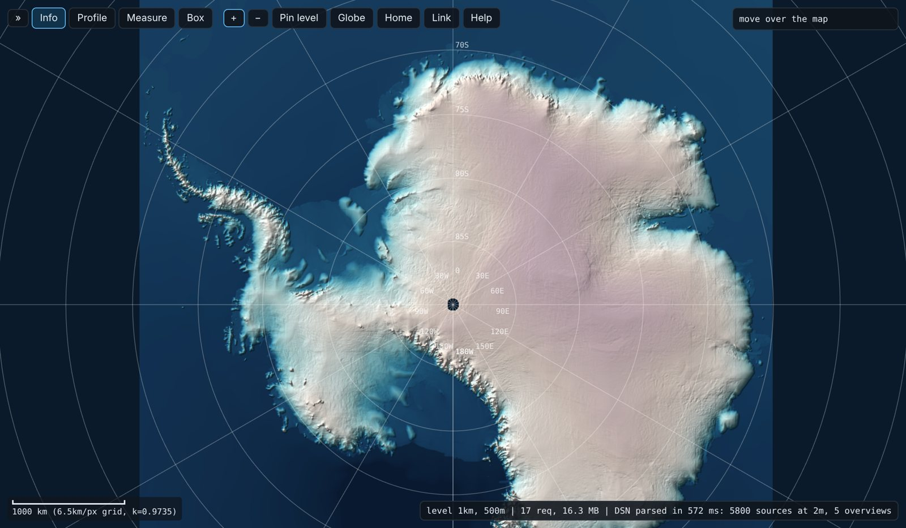
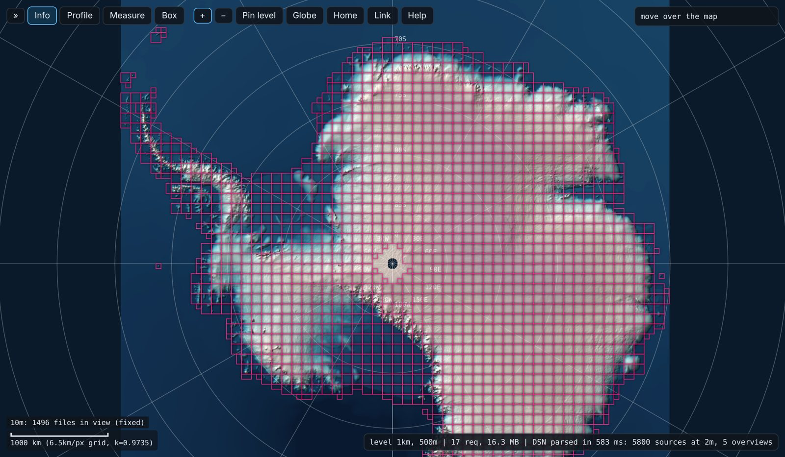
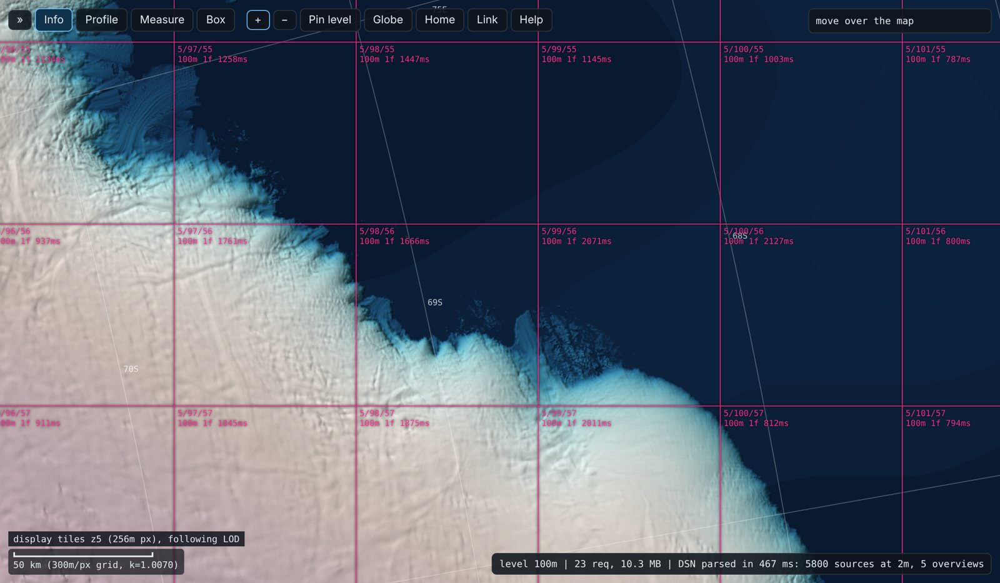
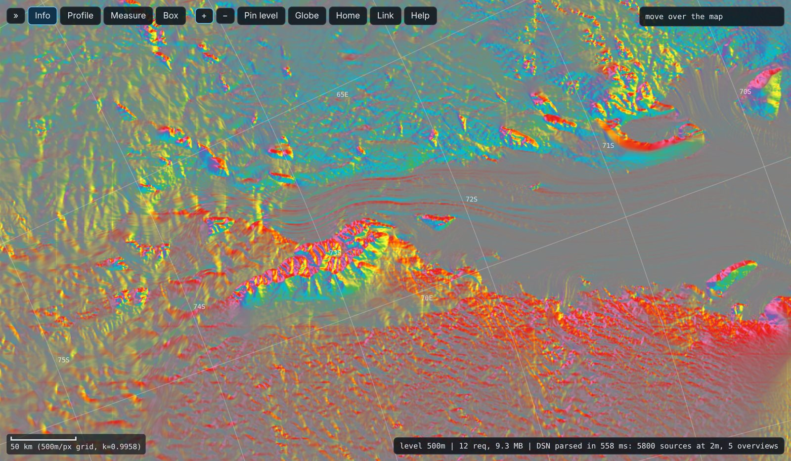
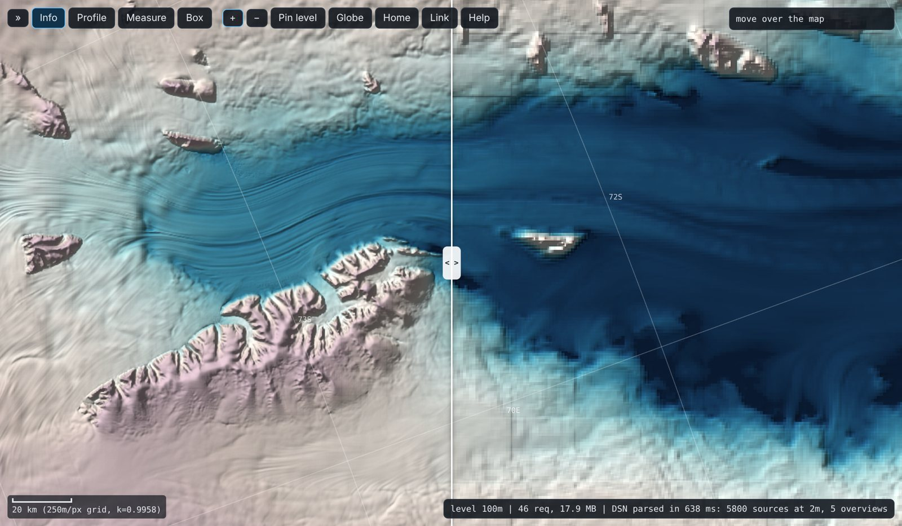
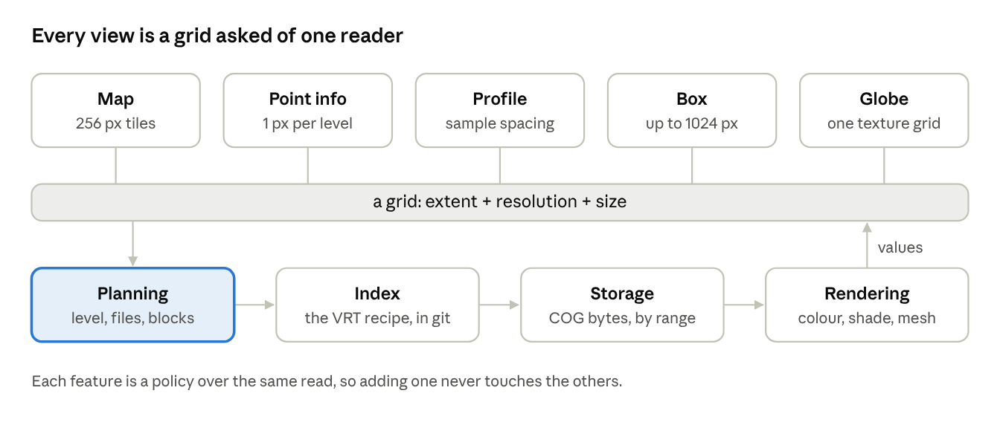
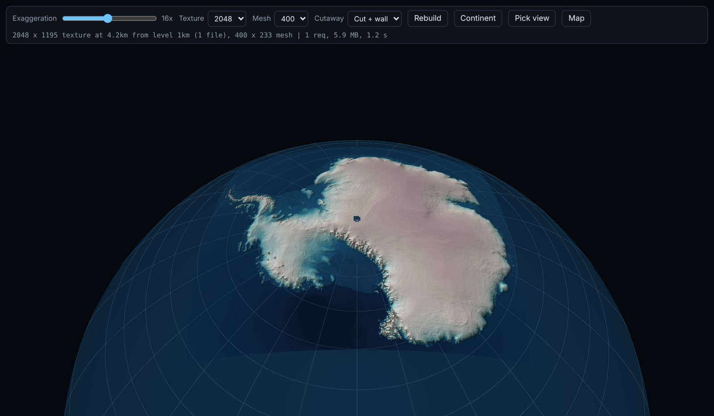
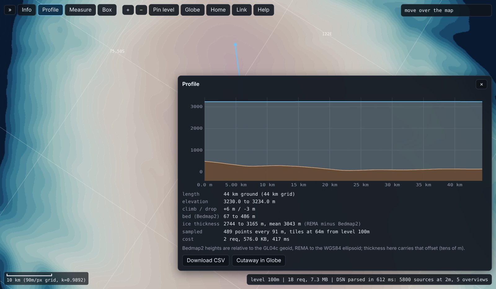

A 3 MB text file makes 5800 cloud-optimized GeoTIFFs behave like one dataset at every scale, from a whole continent at 1 km down to a single valley at 2 m. GDAL has been able to read such a file for years. What is new is that a web page can read it too, the same way, with no server in between, and keep an honest account of what every view costs.

I built (with llm) a REMA explorer to expose what I'd been doing to read REMA at any scale, mostly in R.  Building it shows: most of what we want from a viewer is already possible, and the hard question is not what can be done but how the pieces should be grouped and packaged.

{fig-alt="The whole Antarctic ice sheet in polar stereographic, colour and hillshade"}

## Every tile streams, the continent does not

The [Polar Geospatial Center](https://www.pgc.umn.edu/data/rema/) publishes REMA v2 as tiles: 5800 COGs at 2 m, each about 50 km across, and 1523 each at 10 m and 32 m, 100 km across. Every one of them is a well-made COG. It has internal overviews, so reading a 50 km tile at low resolution is cheap.

But the overviews stop at the tile edge. A view of a 500 km glacier basin touches hundreds of files; a view of the continent touches all 5800, and each one costs at least a header read. The whole-continent mosaics at 100 m, 500 m and 1 km exist, but only inside tarballs. There is no single thing you can point a reader at and ask for "Antarctica at 1 km".

{fig-alt="The continent covered by a grid of 10 m tile footprints in pink"}

The fix is a recipe, not a payload. `REMA-2m_dem_ovr.vrt` mosaics all 5800 2 m COGs by URL and declares five `<Overview>` entries: PGC's own 10 m and 32 m VRTs, then three coarse COGs copied out of the tarballs (100 m as Int16 with sparse tiles, 500 m, 1 km). When a read asks for fewer pixels than the 2 m grid, GDAL picks the overview that fits, exactly as it would inside a single file. The fine data never moves; the only new payload is the cheap end of the pyramid.

```
gdalwarp -tr 1000 1000 /vsicurl/https://raw.githubusercontent.com/mdsumner/rema-ovr/main/REMA-2m_dem_ovr.vrt rema_1km.tif
```

That command and its 2 m twin over one small box both read a bounded number of bytes, because the warper chooses the level for you.

## The browser can be the warper

The explorer fetches that same VRT and does what the warper does, per screen tile, in five steps:

1. **Pick a level.** The display grid is EPSG:3031 with 256 px tiles at 8192 / 2^z m, the same origin as NASA's [polar GIBS](https://nasa-gibs.github.io/gibs-api-docs/) tiles. For a tile at resolution R, take the coarsest level whose pixel is no larger than 1.5 R.
2. **Find the files.** For a VRT level, a bucket index over the `DstRect` footprints gives the files that touch the tile.
3. **Pick an image inside each file.** Same rule again: full resolution or one of its internal overviews.
4. **Read only the window.** Compute the pixel window and ask geotiff.js for those blocks. Single-range requests need no CORS preflight.
5. **Sample into the tile.** Nearest, or bilinear when upsampling, using each file's own georeferencing.

{fig-alt="A coastline with the explorer's display tiles outlined, each labelled with its level, file count and read time"}

Nothing is precomputed. There is no tile cache, no server and no index other than the VRT. The page is a reader of the recipe, the same recipe GDAL, R and Python read.

It also keeps a ledger: requests, bytes and seconds for every settled view. A whole-continent view reads a few megabytes from the coarse overviews of the 1 km file. A 60 km coastal view reads one or two megabytes of the 100 m file. A view at 2 m reads a few blocks of one or two tiles. The area on screen spans six orders of magnitude; the cost does not. That is the whole argument, measured rather than claimed.

## What the usual stack bakes in

None of this is exotic, so it is worth asking why it feels new. The answer is that most tools fuse decisions that should stay separate. Each fusion is reasonable on its own, and each one closes a door.

| Baked-in decision | What it costs | What the recipe approach does instead |
| --- | --- | --- |
| Pre-rendered tile pyramids are the storage | A second copy of the data, styled once, frozen at the build date | The source COGs are the storage; tiles are a view computed on demand |
| Web Mercator is the map | Polar data is distorted or clipped, and the poles are second-class | Each dataset is read in its own CRS; the display grid is a choice, here EPSG:3031 |
| A server makes the tiles | Infrastructure to run, and the client only ever sees pictures | The client is the warper; the server is a static file host |
| Overviews live inside the file | You cannot add a pyramid to data you do not own | External overviews in a VRT add a pyramid to anyone's data by reference |
| Style is baked into pixels | Changing a ramp means re-rendering; a hover shows a colour, not a value | Tiles hold values; colour, hillshade, slope, contours and equalisation are functions applied at draw time |
| One viewer per question | The 2D map, the profile tool and the 3D view are separate programs with separate readers | One read function serves all of them |

{fig-alt="The Lambert Glacier rendered by slope aspect in rainbow colours"}

Even GDAL has a baked-in assumption worth knowing: it treats an overview as covering exactly the extent of the base raster. The 1 km and 500 m files here start 900 m and 400 m outside the 2 m grid, and the 32 m VRT is offset by up to 20 m. GDAL therefore misregisters those levels by up to about one of their own pixels at the edges. The browser reader uses each file's own geotransform and does not. It is a small thing, and exactly the kind of thing that only shows up when you build the machinery yourself.

## Same technology, different gears

Every community in this space uses the same parts: COGs, HTTP range requests, GDAL and PROJ. What differs is the gear they work in, and each gear makes different things easy.

The R spatial community works close to GDAL. A DSN string, the warper and a VRT are everyday tools, and packages like [vapour](https://hypertidy.github.io/vapour/), [gdalraster](https://firelab.github.io/gdalraster/), [terra](https://rspatial.github.io/terra/) and [stars](https://r-spatial.github.io/stars/) expose the warper and the target grid directly. "This extent at this size" is one call, and `target_dim = c(1024, 0)` lets GDAL work out the other side. That habit is why a recipe like this VRT feels ordinary there rather than clever.

The cloud-native trend in Python works a gear up, on chunked arrays: [xarray](https://xarray.dev) over [Zarr](https://zarr.dev), byte references harvested into [kerchunk](https://fsspec.github.io/kerchunk/) or [VirtualiZarr](https://github.com/zarr-developers/VirtualiZarr), [Icechunk](https://icechunk.io) for versioned stores, and tile services such as [TiTiler](https://developmentseed.org/titiler/) for the web. [odc-geo](https://github.com/opendatacube/odc-geo)'s GeoBox is the same grid idea under another name. In JavaScript, [geotiff.js](https://geotiffjs.github.io/), [OpenLayers](https://openlayers.org) and [deck.gl](https://deck.gl) move reading and rendering into the client. These gears are strong for analysis at scale and for services with many users.

The gears differ most at the seams. REMA's 2 m tiles overlap their neighbours by 100 px (200 m), and the 10 m tiles by 20 px. To a VRT, and to this page, that is harmless: the shared pixels are painted twice with the same value, a no-op. To a Zarr store the same overlap is real work. A regular chunk grid cannot describe tiles that start 25000 px apart but are 25100 px wide, and the 512 px blocks inside them do not line up from one tile to the next. Virtualizing it means trimming the overlaps and adopting a rectilinear (variable-size) chunk grid, which Zarr is still standardizing.

Multiscale is the same story. Geospatial Zarr is still converging on how to describe a pyramid, through [GeoZarr](https://github.com/zarr-developers/geozarr-spec) and the multiscales conventions that follow the microscopy world's [OME-NGFF](https://ngff.openmicroscopy.org) precedent, and each level has to be written as its own array. A VRT has had this for years: an `<Overview>` entry points at any other dataset, a file or another VRT, and a mosaic can even mix sources at different resolutions, because each source carries its own scaling from source to destination pixels. That is not a criticism of the Zarr work, which is solving real problems for analysis at scale. It is a reminder that some of what is being engineered as a new paradigm already exists, quietly, one gear down, and that the two can meet: a byte-reference index over these same COGs is just another recipe.

{fig-alt="A swipe comparison of a glacier: sharp 100 m detail on the left, blocky 1 km pixels on the right"}

Neither gear is wrong. The lesson is to keep the grid and the recipe at the bottom, where every gear can reach them, and to choose the gear per question rather than per community.

## One primitive, many policies

The explorer has one primitive: give it a grid (an extent, a resolution, a size) and it returns an array of values. Everything else is a policy about which grid to ask for, or what to do with the answer.

- **The map** asks for 256 px tiles that match the screen.
- **Point info** asks for a 1 x 1 grid at every level's native pixel, so one click shows the same spot through the whole pyramid.
- **A profile** asks for tiles at the resolution of its sample spacing.
- **A box** asks for up to 1024 px across, then hands the result back as a GeoTIFF and as a GDAL, Python or R recipe for the same grid.
- **The globe** asks for one texture-sized grid and drapes it on the WGS84 ellipsoid. REMA heights are ellipsoidal, so exaggeration 1 is geometrically exact.

{fig-alt="Diagram: five views (map, point info, profile, box, globe) each ask for a grid, which flows through planning, index, storage and rendering"}

The level choice is a policy too. Auto mimics the warper; pinning a level reads it at its native pixel size at every zoom, so you see its real pixels. Comparison is the same machinery run twice and swiped. The tile-boundary overlay draws the same index the reader uses: the source files, the 512 px blocks of the overview actually read, or the display tiles, either following the level of detail or fixed to one level.

That last one matters more than it looks. Most viewers hide their machinery. Showing it, as an ordinary layer you can switch on, turns a viewer into an instrument: you can see which file answered, which overview was chosen and what it cost. Because each feature is a policy over the same primitive, adding one never touches the others. The globe did not need a second reader; the cutaway did not need a third.

{fig-alt="Antarctica draped on a 3D globe with vertical exaggeration"}

## What an honest reader exposes

A reader that refuses to fake things finds the gaps in the data, not just in the tools.

- **Products with no pyramid.** PGC also publishes per-pixel count, MAD and min/max date beside every tile. They exist only at 2 m, 10 m and 32 m, so a continent view would mean touching every file. The explorer draws them when you zoom in and says no when you zoom out. That refusal is the argument for building their overviews too.
- **Storage type shows through.** The Int16 100 m overview terraces in 1 m steps, and on flat ice a hillshade at high exaggeration makes that visible. The coarse Float32 overviews with LZW compression are larger than they need to be, and the ledger shows it.
- **Vertical datums collide.** The globe cutaway along the 44 km line from Little Dome C ([Beyond EPICA](https://www.beyondepica.eu/en/)) to Dome C North (the AAD [Million Year Ice Core](https://www.antarctica.gov.au/science/climate-processes-and-change/antarctic-palaeoclimate/million-year-ice-core/) site) drops a wall from the REMA surface to the [Bedmap2](https://doi.org/10.5194/tc-7-375-2013) bed: about 3 km of ice. But Bedmap2 heights are relative to a geoid and REMA's to the ellipsoid, so the thickness carries an offset of tens of metres. The picture makes you notice; a pipeline would not.
- **Hosting is part of the design.** The fine levels only work in a browser if their bucket sends CORS headers. GitHub LFS serves the coarse levels with them, and GitHub release assets do not. Every byte read through LFS counts against a bandwidth quota. These are not footnotes; they decide what a page can see.

{fig-alt="A profile chart: a flat ice surface near 3230 m above a brown bed between 67 and 486 m"}

## Refactoring toward new ways of seeing

If the capabilities are already there, the work is in where the seams go. Four layers fell out of building this, and each can change without the others.

1. **Storage** is bytes in COGs, wherever they live: PGC's bucket, an LFS file, a release, a bucket of our own. It should know nothing about who reads it.
2. **Index** is the recipe: a VRT today, a byte-reference Parquet or a STAC catalogue tomorrow. It is small text, versioned like code, and it is where a pyramid is added to data you do not own.
3. **Planning** answers "for this grid, which level, which files, which blocks?" It is a pure function of the index and the grid. It is also the part worth making visible, because it is where cost is decided.
4. **Rendering** turns arrays into pictures: colour, shading, a profile chart, a mesh. It never reaches past the planner to the bytes.

Two habits make the layers hold. First, make the grid the unit of every request. An extent and a dimension is something GDAL, R, Python and a browser all understand, and `target_dim = c(1024, 0)` lets the tool work out the rest. Second, package by question, not by app. A map, a profile, a box and a globe are not four programs; they are four grids asked of one reader, and a new question should be a new policy, not a new stack.

{fig-alt="A box drawn on the map with stats, a histogram and GDAL and Python recipes for the same extent"}

What comes next follows from the layers. Move storage to a bucket and keep the index in git. Build the missing pyramids for the sibling products. Swap Bedmap2 for [Bedmap3](https://doi.org/10.1038/s41597-025-04672-y) on the same vertical datum, then the cutaway shows true thickness. And let the display CRS be a choice rather than a given, which is where reprojection belongs: in rendering, never in storage.

## Grouping, not capability

Every feature in the explorer was possible before it existed: pyramid-aware reads, polar display, hillshade, profiles, boxes, imagery swipes, a globe, a cutaway. What had been missing was a way of grouping them so that each stays small and none gets in another's way. One reader, grids as requests, policies on top, the machinery on show and a ledger beside it.

The recipe is the dataset. Keep it small, keep it readable by every tool, and the ways of seeing it can keep multiplying without anyone copying the data again.

- Explorer: [mdsumner.github.io/rema-ovr](https://mdsumner.github.io/rema-ovr/), source in [mdsumner/rema-ovr](https://github.com/mdsumner/rema-ovr)
- Howat, I., Porter, C., Smith, B. E., Noh, M.-J., and Morin, P.: [*The Reference Elevation Model of Antarctica*](https://doi.org/10.5194/tc-13-665-2019), The Cryosphere, 13(2), 665–674, 2019. Data from the [Polar Geospatial Center](https://www.pgc.umn.edu/data/rema/)

Earlier pieces this draws on, each one a single idea from the list above:

- [Warp and cell: two worlds that were never separate](https://www.hypertidy.org/posts/2026-10-06_warp-and-cell/) (this site, 2026-10-06): names the recipe-not-payload principle this post builds a working reader around
- [rangefinder](https://hypertidy.github.io/rangefinder/): Sentinel-2 composites from STAC, read and stretched in the browser, no tile server
- [ortho-cog-viewer](https://mdsumner.github.io/ortho-cog-viewer/): COGs reprojected on the fly with a mesh, the display CRS as a choice
- [lunamap](https://mdsumner.github.io/lunamap/): basemaps, coordinates in several forms, and elevation profiles from a 2 m DEM
- [aatgrid](https://mdsumner.github.io/aatgrid/explorer/): a parametric tile scheme, the grid as an explicit, shared object
